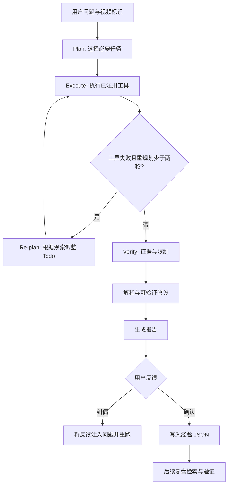

# LangGraph 工作流

## 工具约束

- `metrics`: 仅允许从平台可用指标清单中选择键。
- `comments`: 仅在问题需要评论信号时抓取，并记录清洗前后样本数。
- `history`: 先检索同一创作者已确认且高置信度或经多次验证支持的经验。
- 模型不输出内部思维过程；界面展示 Todo、执行事件、证据和结论。
- 不可用的后台指标作为限制展示，不允许用猜测填补。
